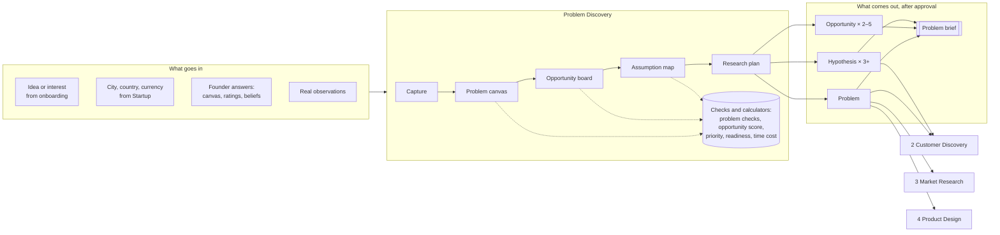
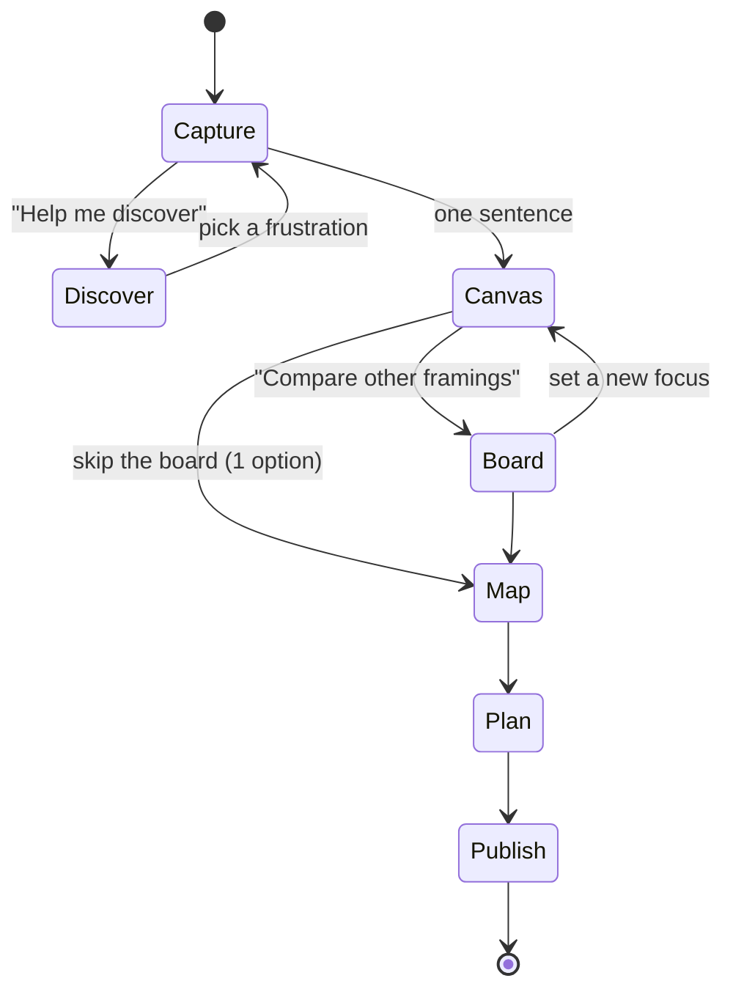

# Pillar 1 — Problem Discovery · SPEC

> **Status: Proposed — awaiting PM sign-off** (Define step, 17 November 2026).
> **v1 is built** (decision 0006) as a simpler subset: canvas with checks and composer, framings with
> weighted scores, beliefs with priority and map, next-week plan, Goals and Report out. This file is the
> plan for **P1 v2** (dashboard tab, Help me discover, observation log, Evidence and Publish details).
> Built from §4.1 and Appendix A.1 of `docs/BLUSLATE_SPEC.md` (v2.5) and decision `0006`.
> Once the PM signs it off, this file is the source of truth for the pillar. The main spec stays
> the source for shared rules (guardrails, Twin, evidence labels, design tokens).

**Question:** What real problem is worth solving?
**Minimum input:** an idea in one line, or an interest area plus city and country (both come from the Home onboarding card).
**Time:** about 10–20 minutes of real time. It costs 2–5 simulated days.
**AI in this version:** placeholders only (decision 0006). Every AI slot has a working non-AI version next to it, so the pillar is fully usable with no model and no API key.

---

## 1. Purpose and value

Most founders arrive with a **solution** ("an app for…", "e-bike rental for…"). Problem Discovery turns that into a **problem worth solving**, a **conscious choice** between ways of framing it, and a **list of the beliefs that could kill it**, ranked so the founder knows what to test first. It does this without AI, with deterministic checks and calculators, and it never claims the problem is validated. Only Customer Discovery and Launch & Growth can provide evidence.

### 1.1 The value this pillar creates, and how

| Value for the founder                                | How it's generated                                                                                                                                                                                                                   | Where it shows                        | Who uses it next                                                                                                |
| ---------------------------------------------------- | ------------------------------------------------------------------------------------------------------------------------------------------------------------------------------------------------------------------------------------ | ------------------------------------- | --------------------------------------------------------------------------------------------------------------- |
| **A clear problem statement with no solution in it** | The Problem canvas asks for six parts (who, pain, frequency, workaround, cost of pain, why now). The statement composer joins them into one sentence. Six problem checks flag solution words, a vague "who" and missing parts (§9.1) | Dashboard hero card · Canvas          | Customer Discovery (who to talk to), Market Research (what to size), Product Design (what the product must fix) |
| **The solution idea is kept, not lost**              | A solution-sounding idea from onboarding is moved to the **Parked solution** card, so the statement can stay clean                                                                                                                   | Dashboard · Canvas                    | Product Design reads it as a starting point                                                                     |
| **Alternatives are visible from day one**            | The canvas asks for at least one current workaround. "Doing nothing" counts. "No competition" phrases are flagged (§9.7)                                                                                                             | Canvas · Reality Check                | Market Research seeds its competitor list from them                                                             |
| **A deliberate choice between 2–5 framings**         | The Opportunity board rates each option on five criteria with written anchors. A weighted score ranks them, and a robustness check says whether the winner holds when the weights change (§9.3, §9.4)                                | Dashboard bar chart · Board           | The focus option becomes the published Problem                                                                  |
| **The riskiest beliefs, ranked**                     | Template starters turn the canvas into testable hypotheses. Each is rated for risk and uncertainty. Priority = risk × uncertainty, placed on a 2×2 map (§9.5, §9.6)                                                                  | Dashboard 2×2 · Assumption map        | Customer Discovery tests them, and hypothesis status is computed from its evidence                              |
| **A next-week research plan**                        | Top hypotheses are grouped by test method and routed to the pillar that can test them, with the simulated time each test costs (§9.8)                                                                                                | Dashboard "Next week" · Plan step     | Customer Discovery, Market Research                                                                             |
| **Honest unknowns**                                  | Any field can be answered "I don't know yet". Unknowns are listed, never filled in silently                                                                                                                                          | Dashboard inputs panel · Evidence tab | Assumptions register, Founder Pack gaps                                                                         |
| **Real observations, logged**                        | A founder observation log records what they saw in the real world (date, place, what happened, a quote). Entries are labelled FIELD                                                                                                  | Evidence tab                          | Customer Discovery evidence board                                                                               |

### 1.2 Takeaways: what the founder leaves with

1. **The problem, in one sentence**, which a stranger could understand and test.
2. **Why this framing and not the others**, with scores and a note on whether the choice is clear or a close call.
3. **What could kill the idea**: the top 3 hypotheses, each with a test and a success line.
4. **What to do next week**: 2–4 concrete research actions with simulated time costs.
5. **What we don't know yet**: the unknown list.

These five are the **Problem brief**, the pillar's deliverable (§3 of the main spec). The dashboard shows them, "Copy brief" copies them as plain text, and the Founder Pack (F1) prints them.

### 1.3 Value flow



---

## 2. The dashboard (unique to Problem Discovery)

Every pillar has its own dashboard (decision 0006). It's the first tab and the pillar opens on it. Problem Discovery's dashboard is the **Problem brief board**. It answers four questions at a glance:

| Question                                    | Panel                                                             |
| ------------------------------------------- | ----------------------------------------------------------------- |
| What did I decide?                          | **A** Problem statement · **B** Problem strength                  |
| Where am I?                                 | **C** Journey strip with the next best action                     |
| What does it mean?                          | **D** Opportunity scores · **E** Assumption map · **F** Takeaways |
| What did this need, and what did it create? | **G** Inputs · **H** Value created                                |

### 2.1 Desktop layout (filled in)

```
┌ City hubs ─┬ 1 · Problem Discovery          [Dashboard]  Work  Evidence  Publish ┬ AI rail ──────┐
│ * 1 Problem│ ┌ A · THE PROBLEM ─────────────── Your decision · v2 ┐ ┌ B · STRENGTH ──┐│ Reality Check │
│   2 Custo… │ │ College students in Pune who live 3–8 km from      │ │  ◉◉◉◉◉○        ││ ✓ No solution │
│   3 Market │ │ campus and don't own a two-wheeler lose time and   │ │  6 of 6 checks ││   words       │
│   4 Product│ │ money getting to class almost every day. Today …   │ │ ✓ No solution  ││ ! "Why now"   │
│   5 Operat…│ │ who ASSUMED · pain ASSUMED · cost ASSUMED · …      │ │ ✓ Specific who ││   has no      │
│   6 Go-to… │ │ Parked solution: Affordable e-bike rental  ↗ P4    │ │ ○ Why now      ││   source      │
│   7 Launch │ └────────────────────────────────────────────────────┘ └────────────────┘│               │
│            │ ┌ C · JOURNEY ─────────────────────────────────────────────────────────┐ │ Next best     │
│ Founder    │ │ ✓ Capture → ✓ Canvas → ✓ Board → ✓ Map → ~ Plan   [Finish the plan →] │ │ action        │
│ Pack       │ └──────────────────────────────────────────────────────────────────────┘ │ Finish the    │
│            │ ┌ D · OPPORTUNITIES ───────────────┐ ┌ E · ASSUMPTION MAP ─────────────┐ │ plan          │
│            │ │ ★ Daily commute  ███████████ 3.9 │ │ risk ▲ Confirm  │ TEST FIRST    │ │               │
│            │ │   Late evenings  █████████▌  3.6 │ │      │   H1     │ H3 H4 H2      │ │ Toolbox       │
│            │ │   Weekend trips  ██████      2.4 │ │      ├──────────┼───────────    │ │ (placeholder) │
│            │ │ Clear winner · ESTIMATE          │ │      │ H6 Safe  │ H5 Explore    │ │               │
│            │ └──────────────────────────────────┘ │      └──────────────────▶ unsure│ │ Ask why       │
│            │                                      └──────────────────────────────────┘ │ (placeholder) │
│            │ ┌ F · YOUR TAKEAWAYS ──────────────────────────────────────────────────┐ │               │
│            │ │ 1 The problem  2 Why this one  3 What could kill it  4 Next week     │ │               │
│            │ │                                5 What we don't know yet [Copy brief] │ │               │
│            │ └──────────────────────────────────────────────────────────────────────┘ │               │
│            │ ┌ G · WHAT THIS NEEDED ──────────┐ ┌ H · VALUE CREATED ────────────────┐ │               │
│            │ │ ✓ Who        You     ASSUMED   │ │ "E-bike rental for students"      │ │               │
│            │ │ ✓ Pain       Start   ASSUMED   │ │        ↓                          │ │               │
│            │ │ ✓ Frequency  You     ASSUMED   │ │ 1 problem · 3 options · 6 beliefs │ │               │
│            │ │ ? Why now    Unknown           │ │ 0 unknowns · 1 observation        │ │               │
│            │ │ …                              │ │ Unlocks → 2 Customers · 3 Market  │ │               │
│            │ └────────────────────────────────┘ └───────────────────────────────────┘ │               │
└────────────┴──────────────────────────────────────────────────────────────────────────┴───────────────┘
```

### 2.2 Phone layout

One column, in this order: **A** problem → **B** strength (as a single row of six ticks) → **C** journey (a vertical list, never a sideways scroll) → **F** takeaways → **D** opportunities → **E** map (square, full width) → **G** inputs (collapsed by default) → **H** value created. The AI rail becomes a "Reality Check" button above the tabs.

### 2.3 Panels

| Panel                    | Shows                                                                                                                                                                                                                                                              | Built from                                   | Empty (not started)                                                                                            |
| ------------------------ | ------------------------------------------------------------------------------------------------------------------------------------------------------------------------------------------------------------------------------------------------------------------ | -------------------------------------------- | -------------------------------------------------------------------------------------------------------------- |
| **A · The problem**      | The composed statement (§9.2). Under it, one chip per part with its evidence label. The parked solution, with an arrow showing Product Design will read it. Solid blue "Your decision" card once approved; dashed card with "Draft" while unpublished              | Problem draft or the latest approved version | The first question (`discoverStarter`) with the three input modes. This is the pillar's "one question" (law 7) |
| **B · Problem strength** | Six checks as six ticks and "N of 6 checks pass". Each check opens its message (§9.1). It's never a percentage and never blocks                                                                                                                                    | `problemChecks()`                            | Six grey ticks: "Checks run as you write"                                                                      |
| **C · Journey**          | Five steps with status (✓ done · ~ started · ○ not started) and one **next best action** button                                                                                                                                                                    | `readiness()` and the step state             | "Start with one sentence"                                                                                      |
| **D · Opportunities**    | Horizontal bars of weighted scores (1–5, one decimal) for every option, best first. ★ marks the focus option. "Clear winner" or "Close call: depends on how much you weigh _X_" (§9.4). The scores carry an ESTIMATE badge; the formula is shown on hover or focus | `opportunityScore()`, `robustness()`         | Ghosted sample bars: "Compare 2–5 ways to frame the problem"                                                   |
| **E · Assumption map**   | A 2×2 of risk (vertical) × uncertainty (horizontal). One dot per hypothesis, labelled H1…Hn. The **Test first** quadrant is tinted. Tapping a dot opens the hypothesis                                                                                             | `priority()`, `quadrant()`                   | An empty grid with the four quadrant names                                                                     |
| **F · Takeaways**        | The five takeaways from §1.2 as numbered cards. "Copy brief" copies them as plain text with labels                                                                                                                                                                 | Every calculator                             | Greyed cards saying what each will hold: "You'll get: …"                                                       |
| **G · What this needed** | Every input in §4 with its status: ✓ given · ? marked unknown · ○ missing. It also shows the source (You · Start card · Startup) and the label                                                                                                                     | Problem draft, Startup                       | The same list, all ○, with "About 10 minutes"                                                                  |
| **H · Value created**    | Before → after (the onboarding idea → the statement); counts of problems, options, hypotheses, unknowns and observations; **Unlocks** chips naming what each downstream pillar will receive                                                                        | Counts and §3.1 of the main spec             | "What you'll unlock": Customer Discovery, Market Research and Product Design, each with one line               |

### 2.4 Dashboard states

| Status (computed, §5.1) | What the dashboard does                                                                                                                                       |
| ----------------------- | ------------------------------------------------------------------------------------------------------------------------------------------------------------- |
| **Not started**         | Panel A is the first question with the three input modes. F, G and H show what the founder will get and what's needed. D and E are ghosted                    |
| **Draft**               | Every panel shows live draft values. A has a dashed border and a "Draft · not published" badge. There's a "Review and publish" button in C                    |
| **Needs review**        | An amber banner at the top: "A suggestion is waiting for you", linking to the Publish tab                                                                     |
| **Approved**            | A is a solid blue card with the version and date. "Change it" opens the Work tab on the canvas                                                                |
| **May be outdated**     | An amber banner says what changed (for example "Your startup's city changed"). The affected panels show a small amber dot. The previous version stays visible |

---

## 3. Work tab: five steps

The Work tab has a step bar: **Capture · Canvas · Board · Map · Plan**. Founders can jump to any step and none is locked, but the next best action follows this order.



### 3.1 Capture

```
┌ What problem do people have? ───────────────────────────────────────────┐
│ From your start card: "Affordable e-bike rental for college students"    │
│ ┌ This sounds like a solution ────────────────────────────── ASSUMED ┐   │
│ │ Good ideas start as solutions. We've parked it, so it's kept for   │   │
│ │ Product Design. Now describe the problem behind it.   [Not a      │   │
│ │                                                        solution]   │   │
│ └────────────────────────────────────────────────────────────────────┘   │
│ [I'll decide]  [Guide me]  [Research & suggest · coming soon]            │
│ ┌──────────────────────────────────────────────────────────────────┐     │
│ │ Students who live a few km from campus lose time and money…      │     │
│ └──────────────────────────────────────────────────────────── 92/280┘    │
│ Don't have one yet?  [Help me discover]                                  │
│                                                    [Continue to canvas →]│
└──────────────────────────────────────────────────────────────────────────┘
```

- **Pre-fill:** if the founder started with an idea, it appears as "From your start card". If it contains solution signals (§9.1, check C1), it's offered as the **parked solution** and the answer box stays empty. "Not a solution" dismisses the suggestion and copies the idea into the box.
- **Help me discover** opens the **Frustration finder**, which works with no AI. It shows six prompt cards about the founder's interest area and city:
  1. What wastes people's time around _{interest}_ in _{city}_?
  2. What do people pay too much for?
  3. What do people complain about again and again?
  4. What clever workaround have you seen someone make?
  5. What feels confusing, scary or unfair?
  6. What changed recently (rules, prices, technology) that makes something newly hard or newly easy?
     The founder writes 2–5 frustrations. Each becomes an Opportunity draft (`source: "frustration"`), and choosing one moves on to the canvas. Next to the cards is the AI placeholder: **"Explore problem spaces with sourced trends — coming when the AI helper is switched on"** (§7).
- **Go and look:** the Frustration finder also offers "Spend 30 minutes watching" with a short checklist (where to stand, what to note, don't pitch anyone). Notes go to the observation log (§5). Nobody is contacted, so no approval is needed.

### 3.2 Problem canvas

```
┌ Problem canvas ──────────────────────────────────────────── Strength ◉◉◉◉○○ ┐
│ ┌ WHO has it? ────────────┐ ┌ PAIN: what goes wrong? ─┐ ┌ HOW OFTEN? ───────┐ │
│ │ College students in Pune│ │ lose time and money     │ │ ( ) Every day     │ │
│ │ who live 3–8 km from …  │ │ getting to class        │ │ (•) Most days     │ │
│ │ ✓ specific              │ │ ✓ no solution words     │ │ ( ) Weekly …      │ │
│ └─────────────────────────┘ └─────────────────────────┘ └───────────────────┘ │
│ ┌ TODAY THEY… (alternatives) ─────────────┐ ┌ IT COSTS THEM ───────────────┐ │
│ │ + Walk                       DIY   ▾    │ │ [Time] [Money] [Stress] [Risk]│ │
│ │ + City bus — late, crowded   Service ▾  │ │ 40–60 min and ₹60–₹120 a day  │ │
│ │ + Autos, bike taxis — costly Service ▾  │ │ Severity ●●●●○                │ │
│ │ + Skip the first lecture     Nothing ▾  │ └───────────────────────────────┘ │
│ └─────────────────────────────────────────┘ ┌ WHY NOW? ────────────────────┐ │
│ ┌ YOU AND THIS PROBLEM ───────────────────┐ │ [New tech] [Price drop] …    │ │
│ │ Lived it · Access to students · Small   │ │ ? I don't know yet           │ │
│ └─────────────────────────────────────────┘ └──────────────────────────────┘ │
│ ┌ Your problem statement (built as you type) ─────────────────────────────┐  │
│ │ College students in Pune who … lose time and money getting to class      │  │
│ │ almost every day. Today they walk, take crowded buses or pay for autos,  │  │
│ │ which costs them 40–60 minutes and ₹60–₹120 a day.                       │  │
│ └──────────────────────────────────────────────────────────────────────────┘  │
│ Parked solution: Affordable e-bike rental                         [Edit]     │
│ [Suggest a reframe · coming soon]                 [Save draft] [Next: Board →]│
└──────────────────────────────────────────────────────────────────────────────┘
```

- There are eight cards: the six Problem parts, "You and this problem" (founder context) and "Parked solution". Every card has the three input modes (§4) and "I don't know yet".
- Each card shows its own check inline (✓ or a short hint) as the founder types. Checks never block.
- **Statement composer** (§9.2) updates live. The founder can switch to "Write it myself". After that, the checks run on their own text and the composer stops overwriting it.
- **"Suggest a reframe"** is an AI placeholder (§7).

### 3.3 Opportunity board

```
┌ Compare ways to frame it ──────────────────────────────── Weights [Edit ▾] ┐
│                      Severity Frequency Urgency Workaround Feasibility Score│
│                       ×3       ×2        ×2      gap ×1     ×2              │
│ ★ Daily commute,       4        5         3       3 → gap 3   4        3.9  │
│   3–8 km students                                                ESTIMATE   │
│   Late evenings after  4        3         4       2 → gap 4   3        3.6  │
│   labs                                                                      │
│   Weekend trips, new   2        2         2       4 → gap 2   4        2.4  │
│   students                                                                  │
│ [+ Add an option ▾]  narrower who · different who · next pain · blank       │
│ Clear winner: "Daily commute" stays first when any weight moves by 1.       │
│ [Suggest ratings · coming soon]          [Make focus ★]  [Next: Map →]      │
└─────────────────────────────────────────────────────────────────────────────┘
```

- **Option 1** is always the current canvas (`source: "problem"`). The founder adds 1–4 more:
  - **Narrower who:** the same pain with a smaller group.
  - **Different who:** the same pain with another group.
  - **Next pain:** the same people with a related pain.
  - **Blank.**
  - Frustrations from Help me discover are added automatically.
- **Rating:** each criterion is rated 1–5 by tapping. Each value has a written anchor (§4.3), and Guide me explains the criterion. Every rating is ASSUMED.
- **Workaround:** founders rate how **good** today's workaround is, because that's easier to judge. The board shows the converted **gap** (6 − rating) and the score uses the gap.
- **Weights:** 0–5 each, defaulting to 3 · 2 · 2 · 1 · 2. "Reset to default" is always available. At least one weight must be above 0.
- **Focus ★:** choosing an option as focus makes it the Problem. If the focus isn't option 1, the canvas is refilled from that option's who and pain, and the founder confirms the change.
- **One option:** a founder can publish with only one option. Readiness then shows "Compare at least 2 framings" as unticked.

### 3.4 Assumption map

```
┌ What has to be true? ─────────────────────────────────────────────────────┐
│ Starters from your canvas: [+ They face it most days] [+ Today's options   │
│ fail them] [+ They'd pay] [+ We can reach them] [+ Why now holds] …       │
│ ┌ H2 · Viability ──────────────────────────────────── priority 25 ESTIMATE┐│
│ │ These students would pay ₹40 or more a day for a faster, reliable ride. ││
│ │ Risk if wrong ●●●●●  Uncertainty ●●●●●   Test: Interviews (past spend) ││
│ │ We're right if: 5 of 10 already spend ₹40+ a day on transport  ✓ testable││
│ └─────────────────────────────────────────────────────────────────────────┘│
│ … H4 20 · H3 16 · H1 12 · H5 12 · H6 6                                      │
│ ┌ map ───────────────────────────┐                                          │
│ │ Confirm   │ TEST FIRST         │  [Suggest hypotheses · coming soon]      │
│ │   H1      │  H2 H4 H3          │                                          │
│ │───────────┼────────────────────│                                          │
│ │ Safe H6   │ Explore  H5        │                                          │
│ └────────────────────────────────┘                     [Next: Plan →]       │
└────────────────────────────────────────────────────────────────────────────┘
```

- **Starters** (§9.9) are built from the canvas and need no AI. The founder accepts, edits or deletes them, and can add new ones.
- Each hypothesis has: statement, kind (desirability · viability · feasibility), risk 1–5, uncertainty 1–5, test method and "We're right if…" (the success line). It's marked **testable** when it passes §9.6.
- The ranked list is sorted by priority (§9.5). The map shows the same hypotheses as dots, and dragging a dot changes its risk and uncertainty.

### 3.5 Research plan

```
┌ Next week ────────────────────────────────────────────────────────────────┐
│ 1 Talk to 10 students who live 3–8 km away         → 2 Customer Discovery │
│   Tests H2, H3, H1 · Interviews · about 5 simulated days                   │
│ 2 Talk to the campus facilities office             → 2 Customer Discovery │
│   Tests H4 · Interview · about half a day                                  │
│ 3 Count students in the 3–8 km band                → 3 Market Research    │
│   Tests H5 · Desk research · 3–7 simulated days                            │
│ Not in this week's plan: H6 (Safe for now)                                 │
│                                          [Open Customer Discovery →]       │
└────────────────────────────────────────────────────────────────────────────┘
```

The plan is **computed, not stored** (§9.8). It's rebuilt from the hypotheses whenever they change, and the founder can't edit it directly. To change it, they change a hypothesis's test method or priority.

---

## 4. Every question, with the three input modes

**The three modes for every field** (§5.3 of the main spec, with decision 0006):

- **I'll decide:** type, pick or tap.
- **Guide me:** a **static concept card** written by us (no AI). It has a 2–3 line explanation, the e-bike example and 2–4 questions. The founder still writes the answer, and their answers to the questions are saved as the rationale.
- **Research & suggest:** an **AI placeholder** card (§7) naming what it will do, plus a link to the non-AI way.

Every field also has **"I don't know yet"**, which adds it to `Problem.unknowns`.

### 4.1 Capture and canvas

| #   | Field                           | Question on screen                            | I'll decide                                                                                                                                                        | Guide me: concept · questions                                                                                                                                              | Research & suggest (placeholder)   | Label                                                     |
| --- | ------------------------------- | --------------------------------------------- | ------------------------------------------------------------------------------------------------------------------------------------------------------------------ | -------------------------------------------------------------------------------------------------------------------------------------------------------------------------- | ---------------------------------- | --------------------------------------------------------- |
| Q1  | `pain` (starter)                | In one sentence, what problem do people have? | Text, ≤280                                                                                                                                                         | "A problem is something that goes wrong for someone, before your product exists." · What goes wrong? · When did you last see it happen? · What happens if nobody fixes it? | `discover.reframeProblem`          | ASSUMED                                                   |
| Q2  | `who`                           | Who has this problem? Be specific.            | Text, ≤140, plus helper chips (age or stage · place · situation)                                                                                                   | "The smaller and clearer the group, the easier it is to find and test." · Where do they live, work or study? · What do they have in common? · Who has it worst?            | `discover.suggestWho`              | ASSUMED                                                   |
| Q3  | `frequencyBand` + `frequency`   | How often does it happen to them?             | Pick: Every day · Most days · Weekly · Monthly · A few times a year · Once, at a big moment. Optional note                                                         | "Frequent problems build habits; rare ones need big pain to be worth solving." · When did it last happen? · Is it seasonal?                                                | —                                  | ASSUMED                                                   |
| Q4  | `alternatives[]` + `workaround` | What do they do about it today?               | 1–6 rows: name + kind (DIY · Product · Service · Do nothing) + "what's wrong with it". At least one; "Do nothing" counts                                           | "There's always an alternative, even doing nothing. It's your real competition." · What did they try last time? · What do they pay for it? · Why isn't it good enough?     | `discover.suggestAlternatives`     | ASSUMED                                                   |
| Q5  | `costOfPain` + `severity`       | What does it cost them?                       | Chips: Time · Money · Stress · Risk · Missed chances. Text, ≤200. Severity 1–5                                                                                     | "Cost of pain is what people lose by living with the problem. It hints at what they might pay." · How much time or money each week? · What else suffers?                   | —                                  | ASSUMED                                                   |
| Q6  | `whyNow`                        | Why is now the right time?                    | Chips: New technology · Price drop · Rule change · Behaviour change · Event. Text, ≤200                                                                            | "Why hasn't this been solved already, and what changed?" · What's different from five years ago? · Who else noticed?                                                       | `discover.suggestWhyNow` (sourced) | ASSUMED. SOURCED only when an AI source is attached later |
| Q7  | `founderContext.experience`     | Have you faced this problem yourself?         | Pick: I live it · I've seen it close up · Not yet                                                                                                                  | "Founders who know the problem first-hand learn faster, but they can also mistake their own view for everyone's."                                                          | —                                  | ASSUMED                                                   |
| Q8  | `founderContext.advantages[]`   | What do you have that helps here?             | Multi-pick: Access to these people · Know-how in this area · Technical skill · Right location · A network · Nothing yet                                            | "Your advantage makes some framings more feasible for you than for others."                                                                                                | —                                  | ASSUMED                                                   |
| Q9  | `founderContext.budgetBand`     | How much could you spend testing this?        | Pick: Savings only · Small (friends and family) · Medium (a grant or an angel) · Large (institutional money) · Not sure. Optional amount in the startup's currency | "This only shapes how feasible each option is. It isn't a plan."                                                                                                           | —                                  | ASSUMED                                                   |
| Q10 | `parkedSolution`                | Your solution idea (parked)                   | Text, ≤200, pre-filled from onboarding when it reads as a solution                                                                                                 | "Keep your idea here. Product Design picks it up after you've checked the problem is real."                                                                                | —                                  | ASSUMED                                                   |

### 4.2 Help me discover

| #   | Field                                          | Question                                  | I'll decide                    | Guide me                          | Research & suggest (placeholder) |
| --- | ---------------------------------------------- | ----------------------------------------- | ------------------------------ | --------------------------------- | -------------------------------- |
| Q11 | `Opportunity.pain` (source `frustration`), 2–5 | The six Frustration finder prompts (§3.1) | One short text per frustration | Each prompt card is its own guide | `discover.exploreSpaces`         |

### 4.3 Opportunity board

Each criterion is rated 1–5. The anchors show on the rating control.

| #   | Criterion (`scores` key) | Question                                    | 1                                                  | 3                                 | 5                                  |
| --- | ------------------------ | ------------------------------------------- | -------------------------------------------------- | --------------------------------- | ---------------------------------- |
| Q12 | `severity`               | How badly does it hurt?                     | A small annoyance                                  | Costs real time or money          | Serious harm or a big loss         |
| Q13 | `frequency`              | How often does it happen?                   | Once in a while                                    | Every week                        | Every day                          |
| Q14 | `urgency`                | How much do they want it fixed now?         | They've accepted it                                | They complain about it            | They're actively looking for a fix |
| Q15 | `workaroundStrength`     | How good is today's best alternative?       | Nothing works                                      | It works, but it's costly or slow | Works well and is cheap            |
| Q16 | `feasibility`            | Could _you_ make a start on it?             | Needs things you don't have                        | Possible with help                | You have the access and skills     |
| Q17 | `weights`                | How much does each criterion matter to you? | 0–5 per criterion, defaulting to 3 · 2 · 2 · 1 · 2 |                                   |                                    |

All criteria share one Guide me card: "Rate what you believe today. Ratings are guesses (ASSUMED) until Customer Discovery tests them." Research & suggest maps to `discover.rateOpportunities` (placeholder).

### 4.4 Assumption map

| #   | Field              | Question                                         | I'll decide                                                                       | Guide me                                                                                                              |
| --- | ------------------ | ------------------------------------------------ | --------------------------------------------------------------------------------- | --------------------------------------------------------------------------------------------------------------------- |
| Q18 | `statement`        | What has to be true?                             | Text, ≤240, or accept a starter                                                   | "Write a belief that real people could prove wrong. Use who, what and how much." · What would make you drop the idea? |
| Q19 | `kind`             | What kind of belief is it?                       | Desirability (they want it) · Viability (it can pay) · Feasibility (we can do it) | One line per kind                                                                                                     |
| Q20 | `risk`             | If this is wrong, how badly does the idea break? | 1 (barely) … 5 (it's over)                                                        | —                                                                                                                     |
| Q21 | `uncertainty`      | How sure are you?                                | 1 (we have proof) … 5 (pure guess)                                                | "Your opinion isn't proof. Score 4–5 unless you've seen real evidence."                                               |
| Q22 | `testMethod`       | How could you test it?                           | Pick: Interviews · Survey · Observation · Desk research · Smoke test · Pre-order  | One line per method, with its simulated time                                                                          |
| Q23 | `successCriterion` | We're right if…                                  | Text, ≤160, with a number or a comparison                                         | "Decide before you test what result would prove you wrong."                                                           |

Research & suggest for hypotheses maps to `discover.hypotheses` (placeholder).

---

## 5. Evidence tab

| Section                | Contents                                                                                                                                                                                                                                                                    |
| ---------------------- | --------------------------------------------------------------------------------------------------------------------------------------------------------------------------------------------------------------------------------------------------------------------------- |
| **Assumptions**        | Every ASSUMED value: field, value, where it's used, status (untested · tested · invalidated). These are written to the assumptions register on publish                                                                                                                      |
| **Unknowns**           | Fields marked "I don't know yet", each with a "How to find out" hint (from the matching test method)                                                                                                                                                                        |
| **Calculations**       | The opportunity score formula with the live numbers filled in, the weights, the robustness result, and priority for each hypothesis. "Download as CSV" for experts                                                                                                          |
| **Consistency checks** | Deterministic warnings (§9.10), for example "Severity 5 but cost of pain is empty" or "Every day, but urgency 1"                                                                                                                                                            |
| **Observation log**    | Real-world notes: date, place, what they saw, an optional quote, and links to hypotheses. Labelled FIELD. Bias note: "One founder's observation. Not a sample." Personal data is not allowed: names and phone numbers are blocked by a simple pattern check, with a warning |
| **Sources**            | Empty in this version ("Sources arrive with the AI helper and Market Research")                                                                                                                                                                                             |

## 6. Publish tab

- **Bundle:** one review covers the Problem (focus framing), every Opportunity and every Hypothesis that changed. The founder can untick any of them. One approval publishes each ticked entity as its own version, each with its own DecisionEvent.
- **Impact preview:** the shared Publish panel. Problem → Customer Discovery, Market Research and Product Design; Hypothesis → Customer Discovery. It also shows the simulated time cost (§11) and the readiness summary.
- **Pivot warning:** on Problem version 2 or later, if `who` or `pain` changed substantially (§9.11), an amber banner says: "This is effectively a pivot. Everything built on the old problem will be marked 'May be outdated'."
- **Reality Check** (rule-based, §9.7) is listed above the Approve button. It never blocks.
- **Labels:** every published value keeps its label. Nothing in this version is SOURCED, SYNTHETIC or ACTUAL. Observations are FIELD.

## 7. AI rail and AI placeholders

The AI rail keeps its place (§6.1). In this version it holds:

| Rail item            | State now                                                                                                                                |
| -------------------- | ---------------------------------------------------------------------------------------------------------------------------------------- |
| **Reality Check**    | **Live, rule-based** (§9.7): solution words, a vague who, "no competition" phrases, "online buzz ≠ demand", "why now" with no source     |
| **Next best action** | **Live, rule-based:** the first unticked readiness item (§10)                                                                            |
| **Toolbox**          | Placeholder until the tool directory exists (§5.10): "Google Trends, an observation log, a whiteboard tool. Coming with verified links." |
| **Ask why**          | Placeholder                                                                                                                              |

**Placeholder card (one design for every AI slot):** a dashed grey "Suggested" card with a sparkle icon and the slot's title (for example "Suggest a reframe"). It says: "Arrives when the AI helper is switched on. For now: _{non-AI way}_", with a link. The button is visibly disabled (`aria-disabled`). A placeholder never shows fake output, sample AI text or a spinner.

**When AI is switched on later**, a slot comes alive only when all three are true: the task is implemented and passes its evals, a model is assigned to Discover in `/admin/models`, and the key is set. Until then the placeholder stays.

| Task (A.1)                   | Slot in the UI                               | Non-AI version available now        | Output contract (Zod items, inside the A.0 envelope)                                                      | Default label                    |
| ---------------------------- | -------------------------------------------- | ----------------------------------- | --------------------------------------------------------------------------------------------------------- | -------------------------------- |
| `discover.reframeProblem`    | Capture and Canvas: "Suggest a reframe"      | Statement composer + problem checks | `{ who, pain, frequency, workaround, costOfPain, whyNow }`, all strings                                   | ASSUMED                          |
| `discover.exploreSpaces`     | Help me discover: "Explore problem spaces"   | Frustration finder                  | `{ spaces: [{ title, who, pain, trendSignal, sourceIds[] }] }`, 3–5 items                                 | SOURCED when cited, else ASSUMED |
| `discover.rateOpportunities` | Board: "Suggest ratings"                     | Rubric anchors + Guide me           | `{ ratings: [{ opportunityId, criterion, value 1–5, reason }] }`. No totals: the calculator computes them | ASSUMED                          |
| `discover.hypotheses`        | Map: "Suggest hypotheses"                    | Template starters (§9.9)            | `{ hypotheses: [{ statement, kind, risk, uncertainty, testMethod, successCriterion }] }`                  | ASSUMED                          |
| `discover.challenge`         | Publish and the rail: "Challenge my problem" | Rule-based Reality Check            | `{ flags: [{ kind: counterexample · alternative · no-competition · buzz, text }] }`                       | ASSUMED                          |
| `discover.explain`           | Guide me: personalised version               | Static concept cards                | `{ concept, example, questions[2–4] }`                                                                    | —                                |
| `discover.suggest<Field>`    | Research & suggest per field                 | Guide me                            | 2–4 ranked options, each `{ value, pros, risks, sourceIds[] }`                                            | SOURCED when cited, else ASSUMED |

The prompts, evals and gateway wiring are **not** part of this Build step. The task ids and output contracts above are fixed now, so turning AI on later doesn't change the UI or the entities. The generic S3 "Guide me" gateway call is replaced in this pillar by the static cards.

---

## 8. Inputs and outputs

### 8.1 Reads

| Type               | Fields used                                                                                      | If missing (standalone)                                                                       |
| ------------------ | ------------------------------------------------------------------------------------------------ | --------------------------------------------------------------------------------------------- |
| `Startup` (shared) | `geography` (city, country), `currency`, `onboarding.idea` or `onboarding.interest`, `entryPath` | City and currency become "?" in the composer and are listed as unknowns. Capture starts empty |

### 8.2 Writes (owned by Discover)

Fields marked **new** are **additive, optional** changes to `packages/contracts/src/entities/discover.ts`. That's a shared package, so they need PM approval (open question 1). No other pillar's contract changes, and every new field is optional, so older data still reads.

**Problem** (one per startup, versioned)

| Field                    | Type                                                                                                                                         | Notes                                                                             |
| ------------------------ | -------------------------------------------------------------------------------------------------------------------------------------------- | --------------------------------------------------------------------------------- |
| `who`                    | string ≤140                                                                                                                                  |                                                                                   |
| `pain`                   | string ≤280                                                                                                                                  | The starter answer                                                                |
| `frequency`              | string ≤120                                                                                                                                  | Free note                                                                         |
| `frequencyBand` **new**  | `daily · most-days · weekly · monthly · few-times-a-year · once`                                                                             |                                                                                   |
| `workaround`             | string ≤240                                                                                                                                  | Summary, composed from `alternatives` unless the founder edits it                 |
| `alternatives` **new**   | `[{ name ≤60, kind: diy · product · service · do-nothing, weakness ≤120 }]`, 1–6                                                             | Market Research can seed competitors from these (it reads, never writes back)     |
| `costOfPain`             | string ≤200                                                                                                                                  |                                                                                   |
| `costKinds` **new**      | `("time" · "money" · "stress" · "risk" · "missed-chances")[]`                                                                                |                                                                                   |
| `severity` **new**       | int 1–5                                                                                                                                      |                                                                                   |
| `whyNow`                 | string ≤200                                                                                                                                  |                                                                                   |
| `whyNowKinds` **new**    | `("technology" · "price" · "rules" · "behaviour" · "event")[]`                                                                               |                                                                                   |
| `statement` **new**      | string ≤600                                                                                                                                  | Composed or founder-written                                                       |
| `statementMode` **new**  | `composed · written`                                                                                                                         |                                                                                   |
| `parkedSolution` **new** | string ≤200                                                                                                                                  | Read by Product Design                                                            |
| `founderContext` **new** | `{ experience: lived · seen · not-yet, advantages: string[], budgetBand: savings · small · medium · large · unsure, budgetAmount?: number }` |                                                                                   |
| `unknowns` **new**       | `string[]` of field names                                                                                                                    |                                                                                   |
| `observations` **new**   | `[{ id, date, place ≤80, saw ≤400, quote? ≤200, hypothesisIds[] }]`                                                                          | Each one is FIELD. It may move to a shared Evidence table later (open question 5) |

**Opportunity** (2–5 per startup, each versioned)

| Field             | Type                                                                         | Notes                                           |
| ----------------- | ---------------------------------------------------------------------------- | ----------------------------------------------- |
| `title`           | string ≤80                                                                   |                                                 |
| `who` **new**     | string ≤140                                                                  |                                                 |
| `pain` **new**    | string ≤280                                                                  |                                                 |
| `source` **new**  | `problem · variation · frustration · ai`                                     |                                                 |
| `scores`          | `{ severity, frequency, urgency, workaroundStrength, feasibility }`, int 1–5 | Keys fixed                                      |
| `weights`         | the same keys, int 0–5                                                       | A copy of the weights used at publish           |
| `total`           | number                                                                       | Calculator output (§9.3). Never typed, never AI |
| `isFocus` **new** | boolean                                                                      | Exactly one is true when ≥1 exists              |

**Hypothesis** (3+ per startup, each versioned)

| Field                      | Type                                                                         | Notes                                                                              |
| -------------------------- | ---------------------------------------------------------------------------- | ---------------------------------------------------------------------------------- |
| `statement`                | string ≤240                                                                  |                                                                                    |
| `kind`                     | `desirability · viability · feasibility`                                     |                                                                                    |
| `risk`, `uncertainty`      | int 1–5                                                                      |                                                                                    |
| `testMethod`               | `interviews · survey · observation · desk-research · smoke-test · pre-order` | Was a free string. It becomes an enum in the UI and stays a string in the contract |
| `successCriterion` **new** | string ≤160                                                                  |                                                                                    |
| `routeTo` **new**          | `customers · market · build`                                                 | Computed from `testMethod` on publish (§9.8), so Customer Discovery can filter     |
| `problemId`                | id                                                                           | Logical id of the Problem                                                          |
| _status_                   | —                                                                            | **Not stored.** Computed from evidence (main spec §3)                              |

**Assumptions register:** on publish, every ASSUMED field value becomes or updates an `Assumption` row: `entityLogicalId`, `field`, `value`, label, confidence (from uncertainty: 1–2 high, 3 medium, 4–5 low; canvas fields default to low) and status `untested`.

### 8.3 Module contract (`src/module.ts`)

| Member              | Behaviour                                                                                                                                                 |
| ------------------- | --------------------------------------------------------------------------------------------------------------------------------------------------------- |
| `schemaVersion`     | `1.0.0` at Build                                                                                                                                          |
| `reads` / `writes`  | `["Startup"]` / `["Problem", "Opportunity", "Hypothesis"]` (unchanged)                                                                                    |
| `validateInput`     | Never blocks. Returns `missing` (empty required parts: `pain`) and `unknown` (`Problem.unknowns`)                                                         |
| `runAnalysis`       | Runs every calculator in §9 and returns a Draft. **No AI call in this version**                                                                           |
| `previewPublish`    | Builds the bundle impact (§6), time cost and pivot flag                                                                                                   |
| `publish`           | Publishes ticked entities with the founder's approval, through the Twin                                                                                   |
| `onUpstreamChanged` | `Startup.geography` or `currency` changed → a StaleMark on the Problem and on every Opportunity (feasibility may change). Any other Startup change → none |

---

## 9. Calculations (pure functions in `src/calculators.ts`, written test-first)

### 9.1 `problemChecks(problem)` → 6 checks

| Id                     | Passes when                                                                                                                                                                                                                                                                                                                                                                                                                                       | Message when it fails                                                                     |
| ---------------------- | ------------------------------------------------------------------------------------------------------------------------------------------------------------------------------------------------------------------------------------------------------------------------------------------------------------------------------------------------------------------------------------------------------------------------------------------------- | ----------------------------------------------------------------------------------------- |
| C1 · No solution       | `pain` and `statement` contain no **solution signal**: (a) a generic list (_app, application, platform, website, portal, marketplace, software, SaaS, AI, chatbot, device, gadget, subscription, startup, solution, "we will", "our", "a way to", "X for Y"_ such as "Uber for"); (b) a word of 4+ letters from `parkedSolution` that does not also appear in `who` (the people aren't the solution). Matching is case-insensitive on whole words | "This mentions a solution (_'e-bike'_). Describe what goes wrong, not what you'll build." |
| C2 · Specific who      | `who` has ≥ 3 words and isn't only a vague word (_everyone, anyone, people, users, customers, consumers, the public, society, all_)                                                                                                                                                                                                                                                                                                               | "Who exactly? Add where they are or what they have in common."                            |
| C3 · Frequency known   | `frequencyBand` set                                                                                                                                                                                                                                                                                                                                                                                                                               | "How often does it happen?"                                                               |
| C4 · Alternative named | `alternatives.length ≥ 1`                                                                                                                                                                                                                                                                                                                                                                                                                         | "Everyone does something today, even nothing. Add at least one."                          |
| C5 · Cost stated       | `costOfPain` non-empty **or** `severity` set                                                                                                                                                                                                                                                                                                                                                                                                      | "What does living with it cost them?"                                                     |
| C6 · Why now           | `whyNow` non-empty **or** `whyNow` is in `unknowns`                                                                                                                                                                                                                                                                                                                                                                                               | "Why now? Or mark it 'I don't know yet'."                                                 |

**Strength** = number of passing checks, shown as "N of 6". A field in `unknowns` passes C3–C5 only as "marked unknown" (a hollow tick), and the dashboard counts hollow ticks separately.

### 9.2 `composeStatement(problem, startup)`

```
{who} {pain} {frequencyPhrase}. Today they get by with {alternativesPhrase}, which costs them {costOfPain}.
```

- **`frequencyPhrase`:**

  | Band             | Phrase               |
  | ---------------- | -------------------- |
  | daily            | "every day"          |
  | most-days        | "almost every day"   |
  | weekly           | "every week"         |
  | monthly          | "every month"        |
  | few-times-a-year | "a few times a year" |
  | once             | "at one big moment"  |

- **`alternativesPhrase`:** the first three alternatives' names, lower-cased and joined as "a, b or c". A `do-nothing` alternative becomes "putting up with it".
- **Missing parts** are dropped with their connecting words, so the sentence still reads. An empty `who` gives "People …" and C2 fails.

### 9.3 `opportunityScore(scores, weights)` → number (1–5)

```
gap        = 6 − scores.workaroundStrength
s          = { severity, frequency, urgency, gap, feasibility }
total      = Σ (weight_k × s_k) / Σ weight_k          (k over the five criteria)
display    = round(total, 1)
```

- **Defaults:** `weights = { severity 3, frequency 2, urgency 2, workaroundStrength 1, feasibility 2 }` (Σ = 10).
- **Constraint:** Σ weight must be > 0. If a criterion isn't rated, the option has no total ("Rate all five to score"), and it never defaults to a value.
- **Labels:** ratings are ASSUMED; the total is ESTIMATE, with this formula shown.
- **Ranking** uses the unrounded total. Ties are broken by higher severity, then higher frequency, then the order the options were added.

### 9.4 `robustness(options, weights)`

For each criterion _k_ and each δ ∈ {−1, +1}, recompute the totals with `weight_k + δ` (clamped to 0–5, skipping cases where Σ = 0).

- **"Clear winner":** the top option is the same in every case.
- **"Close call: depends on how much you weigh _k_":** the top option changes for some _k_. The message names the first such criterion.

### 9.5 `priority(h)` = `h.risk × h.uncertainty` (1–25)

- **Sorting:** by priority descending, then by risk descending, then by the order added.
- **Label:** ESTIMATE.

### 9.6 `isTestable(h)` and `quadrant(h)`

- **Testable when all four are true:**
  - `statement` has ≥ 6 words;
  - `testMethod` is set;
  - `successCriterion` contains a digit or one of _more than, less than, at least, at most, most, half, majority_;
  - for **desirability** hypotheses only, the statement has no solution signal (C1 rules). Viability and feasibility beliefs may name the solution.
- **Quadrant:** "high" means 4–5 and "low" means 1–3.

  |               | Low uncertainty | High uncertainty |
  | ------------- | --------------- | ---------------- |
  | **High risk** | Confirm         | **Test first**   |
  | **Low risk**  | Safe for now    | Explore later    |

### 9.7 `realityCheck(problem, opportunities, hypotheses)` → flags (rule-based Reality Check)

| Flag              | Trigger (case-insensitive phrases across every text field)                                                                              | Message                                                                                             |
| ----------------- | --------------------------------------------------------------------------------------------------------------------------------------- | --------------------------------------------------------------------------------------------------- |
| Solution words    | C1 fails                                                                                                                                | (C1 message)                                                                                        |
| No competition    | _no competition, no competitors, nobody does, no one does, no one else, first of its kind, first ever, nothing like it, no alternative_ | "There's always an alternative, even doing nothing. List what people use today."                    |
| Buzz ≠ demand     | _viral, trending, everyone is talking, lots of posts, reddit, twitter, instagram, youtube comments, people online_                      | "Online talk shows interest, not demand. Test it in Customer Discovery."                            |
| Unsourced why now | `whyNow` set, no source attached                                                                                                        | "Your 'why now' is a belief. Add it as a hypothesis to check." (with a one-tap "Add as hypothesis") |
| Vague who         | C2 fails                                                                                                                                | (C2 message)                                                                                        |

### 9.8 `researchPlan(hypotheses)` and `routeTo`

```
routeTo:  interviews | survey | observation → customers
          desk-research                    → market
          smoke-test | pre-order           → build
```

1. Take every hypothesis except those in **Safe for now**, ordered by priority.
2. Group by `(routeTo, testMethod)` into at most 4 actions. Each action lists its hypotheses (highest priority first) and gets its time cost from Appendix C:
   - interviews: 0.5 day × the suggested sample;
   - survey: 3–7 days;
   - desk research: 3–7 days;
   - observation: 1 day;
   - smoke test or pre-order: "set up in Product Design".
3. **Suggested sample:** interviews 10 per segment-like group (the Customer Discovery "8+" target, rounded up). The founder can't change it here.
4. **Safe for now** hypotheses are listed as "Not in this week's plan".

### 9.9 `hypothesisStarters(problem)` (templates, no AI)

| Kind         | Template (filled from the canvas)                                           | Default test  |
| ------------ | --------------------------------------------------------------------------- | ------------- |
| Desirability | "{who} face this {frequencyPhrase}."                                        | Interviews    |
| Desirability | "{who} find {first alternative} not good enough, because {its weakness}."   | Interviews    |
| Desirability | "{who} would switch from {first alternative} for something clearly better." | Interviews    |
| Viability    | "{who} (or someone on their behalf) already spend money on this problem."   | Interviews    |
| Feasibility  | "We can reach {who} through people or places we already have access to."    | Observation   |
| Feasibility  | "A first test fits a {budgetBand} budget."                                  | Desk research |
| Why now      | "{whyNow} makes this newly possible." (only when `whyNow` is set)           | Desk research |

- **Defaults:** risk 3 and uncertainty 4. The success line is empty, so starters aren't **testable** until the founder writes one.
- **Repeats:** a starter already accepted, with identical text, isn't offered again.

### 9.10 `consistencyChecks(problem, opportunities)`

| Check                                                        | Warning                                                                 |
| ------------------------------------------------------------ | ----------------------------------------------------------------------- |
| `severity ≥ 4` and `costOfPain` empty                        | "You rated it severe. What does it cost them?"                          |
| `frequencyBand = daily` and the focus option's `urgency = 1` | "It happens every day, but nobody wants it fixed. Is that right?"       |
| The focus option's `workaroundStrength = 5`                  | "Today's alternative works well and is cheap. Why would anyone switch?" |
| Focus `who` ≠ Problem `who`                                  | "Your focus option and your canvas describe different people."          |

### 9.11 `isPivot(prev, next)`

True when the token-set overlap (Jaccard, lower-cased words of 3+ letters) is **< 0.5** for `who` or for `pain`.

### 9.12 `timeCostDays(state)` → 2–5

```
days = 2 + (opportunities ≥ 3 ? 1 : 0) + (hypotheses ≥ 5 ? 1 : 0) + (observations ≥ 3 ? 1 : 0)
```

The result is clamped to 2–5. See §11 for how it's applied.

---

## 10. Readiness ("Done when", shown as "N of 6", never blocking)

| #   | Item                              | Rule                                                             |
| --- | --------------------------------- | ---------------------------------------------------------------- |
| R1  | Problem stated without a solution | `pain` set and C1 passes                                         |
| R2  | The people are specific           | C2 passes                                                        |
| R3  | At least one alternative named    | C4 passes                                                        |
| R4  | At least 2 framings compared      | ≥ 2 opportunities fully rated, one in focus                      |
| R5  | At least 3 testable hypotheses    | `isTestable` count ≥ 3 (§4.1 "Done when")                        |
| R6  | Unknowns marked                   | Every canvas field is filled or in `unknowns` (§4.1 "Done when") |

The **next best action** is the first unticked item, phrased as a button: "Name the alternatives", "Compare another framing", and so on. Once all six are ticked it reads "Review and publish". After publishing it reads "Open Customer Discovery".

## 11. Simulated time

- **What's shown:** `timeCostDays` appears in the Publish panel ("This discovery sprint takes about 3 simulated days") and in the research plan.
- **When the clock moves:** it advances on the **first** publish of the bundle, and again only on a pivot. That's when a scenario clock exists.
- **Until then:** Launch & Growth (P7) owns the clock, which doesn't exist yet. The cost is shown and stored on the DecisionEvent, and isn't applied (open question 6).

## 12. States

| State                         | Where                               | Behaviour                                                                                                                                                                |
| ----------------------------- | ----------------------------------- | ------------------------------------------------------------------------------------------------------------------------------------------------------------------------ |
| Empty                         | Dashboard, every step               | Every empty state offers the three input modes (UI rule) and one example from the fixture, shown as greyed "e.g." text                                                   |
| Loading                       | Page load                           | Skeletons in the dashboard panel shapes. There's no long-running work in this version: every calculation is instant and on the client, with a server re-check on publish |
| Autosave                      | Every field                         | Saved on blur, or after 2 s idle, to a Draft per entity. "Saved" or "Saving…" appears in the step bar                                                                    |
| Unsaved                       | Leaving the page with pending edits | A browser "leave page?" prompt                                                                                                                                           |
| Error: save failed            | Any step                            | An inline red message: "Couldn't save. Your text is still here. Try again." The text is never cleared                                                                    |
| Error: publish failed         | Publish tab                         | The Publish panel's error area. Nothing is partly published: if one entity fails, the founder sees which ones succeeded                                                  |
| Validation                    | Field limits                        | A character counter. Typing past a limit is prevented, never truncated silently                                                                                          |
| Personal data in observations | Evidence tab                        | A warning, and the save is blocked, for phone numbers (10+ digits) and emails                                                                                            |
| Needs review                  | Dashboard                           | Amber banner (§2.4)                                                                                                                                                      |
| May be outdated               | Dashboard and panels                | Amber banner and dots (§2.4)                                                                                                                                             |
| AI placeholder                | Every AI slot                       | §7. Never a spinner or fake output                                                                                                                                       |

## 13. Guidance levels (main spec §1.1)

| Level                  | Differences                                                                                                           |
| ---------------------- | --------------------------------------------------------------------------------------------------------------------- |
| **Guided**             | Guide me cards open inline by default. One canvas card at a time. Weights are hidden ("Using recommended weights")    |
| **Standard** (default) | As specified above                                                                                                    |
| **Expert**             | Every canvas card is visible at once. Weights are open. Calculations can be downloaded as CSV. Starters are collapsed |

The engine and every calculation are identical at every level.

---

## 14. Sample fixture (`tests/fixtures/ebike.ts`, the §12.4 reference journey)

Every number below is a founder assumption (ASSUMED) unless it's marked as computed.

```jsonc
{
  "startup": {
    "geography": "Pune, IN",
    "currency": "INR",
    "onboarding": { "mode": "idea", "idea": "Affordable e-bike rental for college students" },
  },
  "problem": {
    "who": "College students in Pune who live 3–8 km from campus and don't own a two-wheeler",
    "pain": "lose time and money getting to class",
    "frequencyBand": "most-days",
    "frequency": "5–6 days a week during term",
    "alternatives": [
      { "name": "Walking", "kind": "diy", "weakness": "40+ minutes, hot in summer" },
      { "name": "The city bus", "kind": "service", "weakness": "late and crowded at 8 am" },
      { "name": "Autos and bike taxis", "kind": "service", "weakness": "₹60–₹120 a day" },
      { "name": "Skipping the first lecture", "kind": "do-nothing", "weakness": "falls behind" },
    ],
    "costOfPain": "40–60 minutes and ₹60–₹120 a day, and missed first lectures",
    "costKinds": ["time", "money", "missed-chances"],
    "severity": 4,
    "whyNow": "E-bikes and app-based unlocking have become cheaper and common",
    "whyNowKinds": ["technology", "price"],
    "parkedSolution": "Affordable e-bike rental for college students",
    "founderContext": {
      "experience": "lived",
      "advantages": ["Access to these people", "Right location"],
      "budgetBand": "small",
    },
    "unknowns": [],
    "observations": [
      {
        "date": "2026-11-12",
        "place": "Bus stop outside the main gate",
        "saw": "About 30 students waited 15+ minutes at 8:10 am; several gave up and shared autos",
        "hypothesisIds": ["H3"],
      },
    ],
  },
  "composedStatement": "College students in Pune who live 3–8 km from campus and don't own a two-wheeler lose time and money getting to class almost every day. Today they get by with walking, the city bus or autos and bike taxis, which costs them 40–60 minutes and ₹60–₹120 a day, and missed first lectures.",
  "opportunities": [
    {
      "id": "A",
      "title": "Daily commute, 3–8 km students",
      "source": "problem",
      "scores": {
        "severity": 4,
        "frequency": 5,
        "urgency": 3,
        "workaroundStrength": 3,
        "feasibility": 4,
      },
      "isFocus": true,
    },
    {
      "id": "B",
      "title": "Late evenings after labs",
      "source": "variation",
      "scores": {
        "severity": 4,
        "frequency": 3,
        "urgency": 4,
        "workaroundStrength": 2,
        "feasibility": 3,
      },
    },
    {
      "id": "C",
      "title": "Weekend trips, new students",
      "source": "variation",
      "scores": {
        "severity": 2,
        "frequency": 2,
        "urgency": 2,
        "workaroundStrength": 4,
        "feasibility": 4,
      },
    },
  ],
  "hypotheses": [
    {
      "id": "H1",
      "kind": "desirability",
      "statement": "Students living 3–8 km from campus spend more than 30 minutes each way on at least 4 days a week.",
      "risk": 4,
      "uncertainty": 3,
      "testMethod": "interviews",
      "successCriterion": "At least 6 of 10 interviewed say yes for last week",
    },
    {
      "id": "H2",
      "kind": "viability",
      "statement": "These students would pay ₹40 or more a day for a faster, reliable ride.",
      "risk": 5,
      "uncertainty": 5,
      "testMethod": "interviews",
      "successCriterion": "At least 5 of 10 already spend ₹40+ a day on transport",
    },
    {
      "id": "H3",
      "kind": "desirability",
      "statement": "Buses and autos fail these students often enough that they'd switch to something better.",
      "risk": 4,
      "uncertainty": 4,
      "testMethod": "interviews",
      "successCriterion": "Most interviewed describe a bad trip in the last 2 weeks",
    },
    {
      "id": "H4",
      "kind": "feasibility",
      "statement": "The college will allow parking and charging space near the main gate.",
      "risk": 5,
      "uncertainty": 4,
      "testMethod": "interviews",
      "successCriterion": "The facilities office agrees to at least 1 trial spot",
    },
    {
      "id": "H5",
      "kind": "feasibility",
      "statement": "Enough students live 3–8 km away to keep 50 bikes busy on weekdays.",
      "risk": 3,
      "uncertainty": 4,
      "testMethod": "desk-research",
      "successCriterion": "More than 1,000 students live in the band",
    },
    {
      "id": "H6",
      "kind": "feasibility",
      "statement": "Cheaper e-bikes and app unlocking make a small fleet affordable this year.",
      "risk": 2,
      "uncertainty": 3,
      "testMethod": "desk-research",
      "successCriterion": "At least 2 suppliers quote within our small budget",
    },
  ],
}
```

**Expected results (the acceptance tests use these):**

| Calculator         | Expected                                                                                                                        |
| ------------------ | ------------------------------------------------------------------------------------------------------------------------------- |
| `problemChecks`    | 6 of 6 pass. If `pain` were the onboarding idea, C1 would fail on "e-bike" and "rental"                                         |
| `composeStatement` | Equals `composedStatement`                                                                                                      |
| `opportunityScore` | A = (12+10+6+3+8)/10 = **3.9** · B = (12+6+8+4+6)/10 = **3.6** · C = (6+4+4+2+8)/10 = **2.4**                                   |
| `robustness`       | **Clear winner** (A stays first for every ±1 weight change)                                                                     |
| `priority` / order | H2 25 · H4 20 · H3 16 · H1 12 · H5 12 · H6 6 (H1 is before H5: higher risk)                                                     |
| `quadrant`         | H2, H4, H3 Test first · H1 Confirm · H5 Explore later · H6 Safe for now                                                         |
| `isTestable`       | All 6 testable                                                                                                                  |
| `researchPlan`     | 1) customers / interviews: H2, H4, H3, H1 → 10 interviews ≈ 5 days · 2) market / desk research: H5 → 3–7 days · Not in plan: H6 |
| `readiness`        | 6 of 6                                                                                                                          |
| `timeCostDays`     | 2 + 1 (3 options) + 1 (6 hypotheses) + 0 (1 observation) = **4**                                                                |
| `realityCheck`     | One flag: "Unsourced why now"                                                                                                   |

_Note:_ the research plan groups H4 (campus facilities) with the student interviews, because both route to Customer Discovery interviews. The Build step may split actions by who is interviewed if the PM prefers (open question 7).

## 15. Acceptance tests

**Calculators (Vitest, written first):**

1. `opportunityScore` returns 3.9 / 3.6 / 2.4 for the fixture. An unrated criterion returns no total. Σ weights = 0 is rejected.
2. Workaround strength is inverted: changing A's `workaroundStrength` from 3 to 1 raises its total by 0.2 (from 3.9 to 4.1).
3. `robustness` returns "Clear winner" for the fixture. With B's urgency set to 5, "Close call" names a criterion.
4. `priority` and the ranking order match §14, including the H1/H5 tie-break.
5. `quadrant` covers all four corners and the 3/4 boundary.
6. `problemChecks`: the onboarding idea fails C1 and names "e-bike". The fixture statement passes C1 even though it contains "college students" (they're in `who`). "Everyone" fails C2. "Do nothing" alone passes C4.
7. `composeStatement` matches the fixture and reads correctly with each optional part missing.
8. `isTestable` fails with no success line, with a success line that has no number or comparison, and for a desirability belief with a solution word. H6 (feasibility, mentions e-bikes) still passes.
9. `realityCheck` raises "No competition" for "there is no competition", and "Buzz" for "it's trending on instagram".
10. `researchPlan` routes by method, caps at 4 actions and lists excluded hypotheses.
11. `isPivot` is true for the who "Office workers in Mumbai" against the fixture who, and false for a one-word edit.
12. `timeCostDays` = 4 for the fixture and is clamped to 2–5.

**Module and Twin (Vitest, InMemoryTwinStore):**

13. `runAnalysis` makes no network or AI call. A test asserts that the gateway is never invoked.
14. `publish` without a `FounderApproval` is rejected. With one, Problem, 3 Opportunities and 6 Hypotheses become versions, each with a DecisionEvent.
15. On publish, ASSUMED fields create Assumption rows with status `untested`.
16. `onUpstreamChanged` for a Startup geography change marks the Problem and every Opportunity as may be outdated. A Startup name change marks nothing.
17. Contracts: data saved with the S3 starter (`{ pain }` only) still parses and opens in the canvas.

**End-to-end (Playwright, desktop + mobile):**

18. **Standalone:** a new founder with the idea "Affordable e-bike rental for college students" lands on the dashboard. It shows the first question, and the idea is offered as a parked solution.
19. Filling the canvas from the fixture shows 6 of 6 checks, and the composed statement equals the fixture.
20. Adding B and C with their fixture ratings shows bars of 3.9 / 3.6 / 2.4 and "Clear winner". The ★ is on A.
21. Accepting and editing six hypotheses places H2, H4 and H3 in the Test first quadrant.
22. The dashboard takeaways list the fixture problem, "Daily commute", H2/H4/H3 and two plan actions. "Copy brief" copies plain text that contains the labels.
23. Publish shows the impact on Customer Discovery, Market Research and Product Design and "about 4 simulated days". After approval, Customer Discovery's city hub reads the Problem.
24. Every number on the dashboard has an evidence badge (ASSUMED or ESTIMATE).
25. Every AI slot is a disabled placeholder with a working non-AI link, and no AI request is sent (network assertion).
26. Mobile: no page scrolls sideways, and the panels appear in the §2.2 order.
27. "I don't know yet" on Why now leaves C6 passing (hollow) and R6 ticked, and lists Why now under Unknowns.
28. Help me discover: entering three frustrations creates three options on the board.

**Guardrails:**

29. No statistic is shown without a label, and nothing in the pillar is labelled SOURCED or ACTUAL in this version (G2/G3).
30. An observation containing a 10-digit number can't be saved (personal data).

---

## 16. Open questions for the PM

1. **Contract additions** (§8.2): approve the additive, optional fields on Problem, Opportunity and Hypothesis in `packages/contracts`? _(Recommended: yes. Nothing else changes.)_
2. **The Dashboard tab for every pillar** (decision 0006): the shared shell gets tabs **Dashboard · Work · Evidence · Publish** and opens on Dashboard. Approve this shared-shell change at P1 Build? _(Recommended: yes. The other six pillars show their placeholder dashboard until their own Define step.)_
3. **Default weights** 3 · 2 · 2 · 1 · 2 (severity heaviest, workaround gap lightest)? _(Recommended.)_
4. **Quadrant threshold:** "high" = 4–5. _(Recommended: it keeps "Test first" short.)_
5. **The observation log** is stored on the Problem for now (FIELD per entry). Should it move to a shared Evidence table in Customer Discovery? _(Recommended: keep it on the Problem now; revisit at P2.)_
6. **Simulated time:** show and store the 2–5 days now, and apply them to the clock when P7 builds it? _(Recommended.)_
7. **Research plan:** group by method only (as specified), or split by who is interviewed (students vs campus office)? _(Recommended: by method now. Customer Discovery plans the outreach anyway.)_
8. **Budget bands** use words (Savings only · Small · Medium · Large), not currency amounts, so no conversion rates are needed. OK? _(Recommended.)_
9. **Business type:** §4.1 lists "business type if known" as an input. `Startup.businessType` is shared, so Discover doesn't write it. Ask for it in Product Design (which owns the archetype) instead? _(Recommended.)_

## 17. Out of scope for this Build

- Live AI: prompts, evals, the gateway wiring and web search (decision 0006).
- The Founder Pack PDF of the Problem brief (F1). "Copy brief" covers it until then.
- Hypothesis status (validated · invalidated · unclear): computed from evidence in Customer Discovery (P2).
- The Founder Toolbox with verified links: it needs the tool directory (§5.10).
